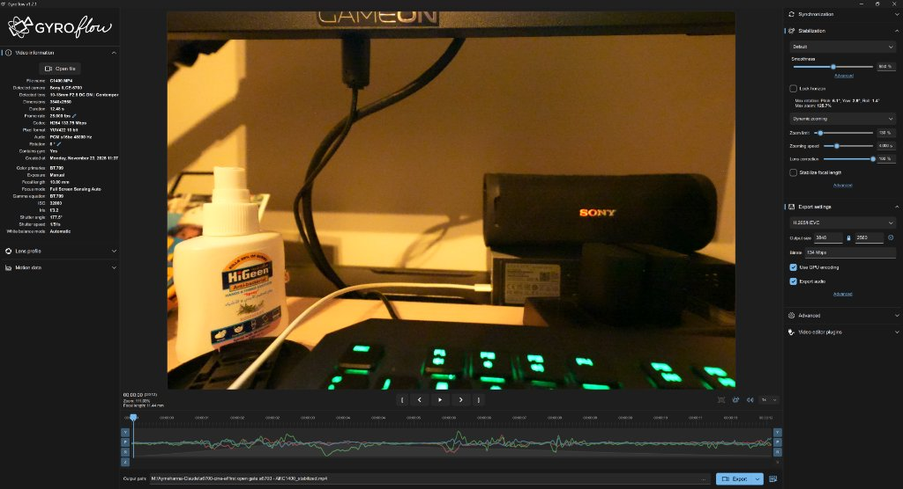

# Sony a6700 Open Gate (4K 3:2) + Cine EI + FL2/FL3 + Fuji Sims — v6.1 (100% RAM-Only)

Temporary, **zero-flash RAM-only** mod kit for the **Sony ILCE-6700 (a6700) on Firmware v2.00**.

Unlocks true **3:2 Open Gate (`3840 × 2560`, 10-bit 4:2:2)** across **XAVC HS 4K, XAVC S 4K, and XAVC S-I 4K All-Intra** (25p PAL & 24p NTSC, with **4K 50p/60p left 100% stock 16:9**), full **synced Gyroflow metadata (`18.76 ms` rolling shutter readout time)**, **FX30 Cine EI (`v2.2`)**, **FX2 FL2 / FL3 Creative Looks**, and **4 Hardware Fujifilm Film Simulations** — all stackable in **ONE single ~17-second USB session** with **zero permanent flash writes**.

---

## What's New in v6.1

- **True 1-Plug All-in-One Combo (`combo_all_in_one.cmd` / `--combo` & `--combo-fuji`):** Loads **Open Gate + Cine EI + Creative Looks** sequentially inside **ONE single USB session (~17 seconds)** — no unplugging/replugging between modules.
- **All 3 4K Codecs (XAVC HS + XAVC S + XAVC S-I 4K All-Intra):** Fixed the `+0x90` `A2-profile` height offset on AVC (`XAVC S`) & All-Intra (`XAVC S-I`) in `av-cam.bin`, while keeping **4K 50p/60p 100% untouched stock 16:9** so switching to 50p/60p never trips encoder OOM.
- **Native `3840 × 2560` MP4 Container Headers (`libXavcMp4`):** Patches `tkhd`, `stsd`, and `pasp` height emitters in `libmpr.so` private COW RAM so NLEs read 3:2 natively without needing an FFmpeg remux. *(Live-applied cleanly on camera; awaiting first PC `.MP4` header inspection via SD card reader — FFmpeg remux remains a fallback if needed.)*
- **Cine EI v2.2 (Strict Idempotent):** Safely detects if Cine EI is already loaded (`RESULT=ALREADY_APPLIED`, `0` writes) so accidental re-runs can never double-decrement exclusion counts.
- **4 Hardware Fujifilm Film Simulations (`fuji_film_sims.cmd` / `--fuji`):** Full 3-layer hardware ISP emulation (Tone Curve + Chroma + 48×6 Color Matrix, Photo + Movie): `FL` → **Classic Chrome**, `VV2` → **Classic Negative**, `IN` → **Nostalgic Negative**, `SH` → **Eterna / 2383** (live-verified on a6700).
- **1-Click Factory-Stock Creative Look Restore (`restore_stock_looks.cmd` / `--restore-looks`):** Cleanly restores Creative Look tables and wipes Sony's normal-power-off Chroma/Matrix cache back to **100% factory stock** without resetting any custom buttons or menus!

---

## What's Included

| Feature | Status (a6700 FW v2.00) | Details |
|---|---|---|
| **Open Gate 4K 3:2 v6.1** (`open_gate_4k.cmd`) | **Live-verified (PAL 25p)** | `3840 × 2560` (true 3:2, square pixels), 10-bit 4:2:2 across **XAVC HS 4K, XAVC S 4K, XAVC S-I 4K All-Intra**, 3:2 rear LCD preview with aligned AF/tracking frames, synced Sony Gyroflow metadata (`18.76 ms` readout), native 3:2 MP4 header patch. **4K 50p/60p stays stock 16:9.** *(NTSC 24p calibrated & included; awaiting first NTSC tester.)* |
| **Cine EI v2.2** (`cine_ei.cmd`) | **Live-verified** | Unlocks Log Shooting → **Cine EI** (Base ISO 800 / 2500 + LUTs), strict idempotent re-run guard, stacks cleanly with Open Gate. |
| **FX2 FL2 & FL3 Looks** (`fl2_fl3.cmd`) | **Live-verified** | Authentic Sony FX2 **FL2** (onto Creative Look `IN`) and **FL3** (onto `SH`), stacks cleanly with Open Gate & Cine EI. |
| **Fujifilm 4-Sim Pack** (`fuji_film_sims.cmd`) | **Live-verified** | 3-layer hardware Tone Curve + Chroma + 48×6 Matrix for Photo & Movie: `FL`=Classic Chrome, `VV2`=Classic Negative, `IN`=Nostalgic Negative, `SH`=Eterna. |
| **1-Plug Combos** (`combo_all_in_one.cmd` / `a6700_launcher.cmd` → `5` or `6`) | **Live-verified** | Stacks **Open Gate v6.1 + Cine EI v2.2 + FX2 FL2/FL3** (or **Fuji 4-Sim**) in **ONE ~17s USB session**. |
| **Factory-Stock Look Restore** (`restore_stock_looks.cmd`) | **Live-verified** | Restores `FL/VV2/IN/SH` descriptors, param-maps, Chroma/Matrix slots, and Gamma caves to 100% stock so a normal power-off clears Sony's Creative Look cache cleanly. |
| **Pro Pack** (`a6700_launcher.cmd` → `P`) | *Built & offline-audited* | Optional AP-RAM unlocks: Power-Off Shutter Curtain, Flexible Exposure, Native FTP. |

---

## Safety Guarantees

- **100% RAM-only / zero flash writes:** Never touches `/dev/nflash*`, `/cp/cpapp-b.bin`, `/usr/lib/appFw.so`, or `/setting/BACKUP.BIN`. Zero CP executable code patches.
- **Strict Firmware v2.00 SHA-256 lock:** Every payload verifies the exact on-disk SHA-256 of `/libsencore.so`, `/libmpr.so`, `/libJiritsu.so`, `/usr/lib/appFw.so`, CP code pages, and every target byte before writing anything. If anything doesn't match stock ILCE-6700 FW v2.00, it aborts with `0` writes.
- **Automatic rollback:** If any write fails readback, every touched site is restored to stock automatically.
- **Same-session cleanup:** All temporary staging files in `/tmp/jiritsu/` are automatically deleted before the USB session closes.
- **Full source included:** All 11 `.so` payloads in `payloads/` compile cleanly (`-Wall -Wextra -Werror`) from freestanding C source in `src/` (`DT_NEEDED = 0`, `< 64 KiB`) and are SHA-256 pinned in `payloads/manifest.json`.

---

## Windows Quick Start

### One-Time Setup
1. Install **Python 3.10+** from [python.org](https://www.python.org/downloads/) (check **"Add Python to PATH"**).
2. Double-click **`windows\setup.cmd`** — creates a local `.venv`, installs `pyusb` + `pycryptodomex`, and verifies every `.so` payload's SHA-256 offline (zero USB calls).
3. Install the **`libusb-win32`** USB driver with **[Zadig](https://zadig.akeo.ie/)**:
   - On the camera: **Menu → Setup → USB → USB Connection Mode → Mass Storage (MSC)**.
   - Connect the camera to your PC via USB (it appears as `ILCE-6700`).
   - Open **Zadig → Options → List All Devices**, select your Sony camera (`VID 054C / PID 0E76`), and replace the driver with **`libusb-win32`**.
   - *(On the very first run, the camera switches to Sony Service Mode `PID 0336`; if Windows doesn't assign `libusb-win32` to `0336` automatically, run Zadig once more on `0336` too.)*

### Running Open Gate / 1-Plug Combo (Every Time You Want to Shoot)
1. Set your camera's Movie format to **XAVC HS 4K, XAVC S 4K, or XAVC S-I 4K** at **25p** (PAL) *(or **24p** NTSC)*.
2. **Power the camera ON while the mode dial is on Photo / Stills** *(important! Open Gate must patch the raw buffer table before Movie mode initializes its memory pools)*.
3. Plug in USB → select **Mass Storage (MSC)**.
4. Double-click **`windows\combo_all_in_one.cmd`** *(for 1-Plug Open Gate + Cine EI + FL2/FL3)*, **`windows\open_gate_4k.cmd`** *(Open Gate only)*, or **`windows\a6700_launcher.cmd`** *(full menu including Fuji 4-Sim & Stock Restore)*.
5. Wait for **`RESULT=APPLY_OK`** (~5s single / ~17s 1-Plug Combo), unplug USB, and switch the dial to **Movie** — you're live in **3:2 Open Gate (`3840 × 2560`)**!

## macOS Quick Start
1. Install [Homebrew](https://brew.sh), then run `chmod +x mac/*.command && ./mac/setup_mac.command` once (installs `libusb`, creates `.venv_mac`, verifies all 11 payloads offline).
2. Run `./mac/a6700_launcher_mac.command` (prompts for `sudo` for direct USB access; unmount the SD card in Finder if macOS reports USB busy).

---

## Returning to 100% Factory Stock (Important Tips!)

- **If Cine EI is turned ON:** Switch **Log Shooting → Off** on the camera screen/menu **before** pulling the battery (Sony's stock firmware saves the active `Log Shooting` mode into user settings across reboots).
- **If you ran FL2/FL3 or Fuji Film Sims and want stock Creative Looks back:** Sony's normal power-off caches the Creative Look Chroma/Matrix tables (`0x02A40001` / `0x02A4000D`) into settings. To restore 100% factory Creative Looks without losing any of your custom buttons or menus:
  1. Run **`windows\restore_stock_looks.cmd`** (or `a6700_launcher.cmd` → `7`) until `RESULT=RESTORE_STOCK_OK`.
  2. Unplug USB and **power the camera OFF normally once** (saves the clean stock tables).
  3. **Pull the battery for ~10 seconds** → both AP Linux RAM and CP sensor RAM reset cleanly to **100% factory stock**.
- **If you only ran Open Gate:** Just **pull the battery for ~10 seconds** (flipping the power switch OFF/ON only sleeps Linux RAM; a 10s battery pull resets both AP and CP cleanly).

---

## Known Notes & Limitations

- **"Unable to display" during in-camera playback is completely normal:** Sony's built-in camera player only decodes 16:9 clips. Your `.MP4` files on the SD card (`PRIVATE\M4ROOT\CLIP\`) play cleanly in **Gyroflow, VLC, DaVinci Resolve, Premiere Pro**, etc.
- **4K 50p / 60p stays stock 16:9:** Intentionally left untouched in `v6.1` so you can still shoot normal 4K 50p/60p cleanly without crashing.
- **Keeping Open Gate active between shots:** Leave the power switch ON, set **Power Save Start Time → Off**, and use a **USB-C PD power bank** or dummy battery for long sessions.
- **NLE compatibility fallback:** `v6.1` patches `libXavcMp4` in RAM to emit native `3840 × 2560` MP4 headers. If any player still shows a squeezed frame before our PC clip check confirms every codec, remuxing with `ffmpeg -i input.mp4 -map 0:v:0 -map 0:a? -c copy -movflags +faststart fixed.mp4` fixes the container flags *(run Gyroflow first on the original `.MP4` so `rtmd` gyro metadata stays intact!)*.
- **Firmware v2.00 only:** Do not attempt to bypass the firmware check on other firmware versions.

---

## Technical Notes (How a6700 Open Gate v6.1 Works)

- **Exact 3:2 sensor readout (`5952 × 3968`):** Uses the IMX684's factory V-ROI mode (`r2 = 0x05`, `S5 = 2`, `S6 = 2`, `top_ob = 26`) with `H_act = 3968`, `S2 = 70` (active rows `76..4044`, cleanly clear of the 28-row top border), `vcn = 1990` (`0x07C6 < 0x0800`), `S10 = 80` (`pd_st = 2`, `pd_cnt = 40`, `S9 = 47`, `S8 = 121`), and `CSDrvParam` vertical sampling ratio `27/32` (`3968 × 27 / 32 = 3348.0` exact stock height → `3840 × 2560` square pixels).
- **Fits Sony's PAL 50.000 Hz `XVS` sync budget:** On PAL `0x0880` (`25p`), Sony clocks the sensor at `50.000 Hz` (`20.000 ms`, `v_tot = 4,230` total SLVS-EC lines). At `3,968` rows, total SLVS-EC lines drop to **`4,136` (`19.56 ms < 20.00 ms`, `+94` lines V-blank margin)** and `S3 = 2,014 < VMAX 2,115`.
- **Preserves all 7 of 7 `key 0x57f` RAW DMM buffers:** `H_stg = 3,976` → `3,976 × 6,016 = 23,919,616 B` (`0x016CFC00`). Three buffers take `71,758,848 B <= 74,448,896 B` (stock `71.00 MiB` `0x6fa` parent pool, `+2.57 MiB` spare), satisfying the 6-buffer upfront allocation in `cpapp-b.bin` without parking any buffers.
- **294 verified atomic Open Gate sites (0 CP code sites):** 4 `DmmCfg` sites + 25 CP sensor cells + 3 rear-LCD `lcdfill_v2` data sites + 2×3000B ISP records + 2×29B `CSDrvParam` (`0x08c0`, `0x0880`) + 1 CP size table + 11 `libmpr.so` COW sites (5 comb + 6 `libXavcMp4` native 3:2 headers) + 2 `av-cam.bin` blobs + 244 `av-cam.bin` descriptor/profile height sites (61 descriptors × 4 fields across `XAVC HS/S/S-I` 24p/25p, including `+0x90` for AVC/All-Intra).
- **Rebuilding from source:** Install Zig 0.13+ and run `python src/build.py`.

---

## Credits & Special Thanks

This project stands on the shoulders of awesome Sony camera research by the community:

- **[ArcaneLantern](https://github.com/ArcaneLantern)** — A7 IV & A7S III Open Gate architecture, ISP 3000-byte record mapping, DMM raw write buffer sizing, `lcdfill_v2`, and `ogfile2560` encoder methodology.
- **[FireHydrant / Himpq](https://github.com/himpq)** — Jiritsu USB service transport (`jiritsu.py`, MIT License) and BIONZ XR research.
- **[ma1co / Sony-PMCA-RE](https://github.com/ma1co/Sony-PMCA-RE)** — Sony MSC → Service Mode authentication (`sony-pmca-re`, MIT License).
- **Powerful6700 / A7C II & a6700 community researchers** — FX30 Cine EI, FX2 FL2/FL3 Creative Look tables, and Pro Pack feature research.
- **[Erlla/sony-a7m4-custom-firmware](https://github.com/Erlla/sony-a7m4-custom-firmware)**, **[DavidBuchanan314/fwtool.py](https://github.com/DavidBuchanan314/fwtool.py)**, and **[leogenot/sony-a7iv-feature-research](https://github.com/leogenot/sony-a7iv-feature-research)** — foundational BIONZ XR USB service & firmware analysis.

---

## License

Licensed under **GNU General Public License v3.0** (see [LICENSE](LICENSE)). Vendored third-party libraries retain their original MIT licenses in `runner/third_party/`.
